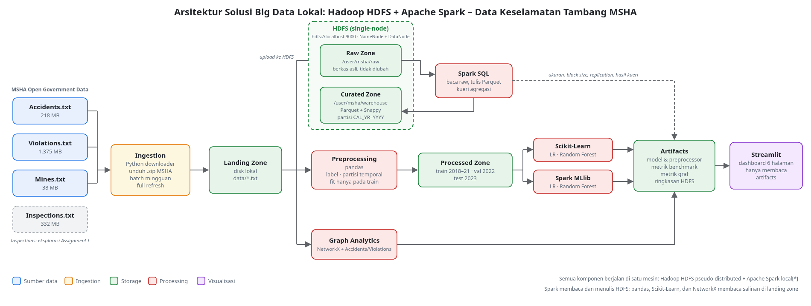
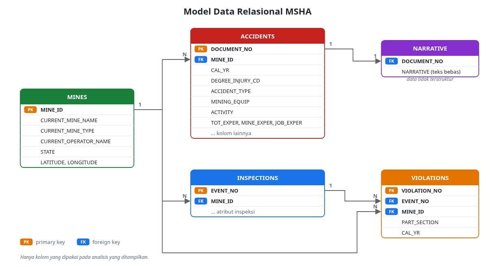
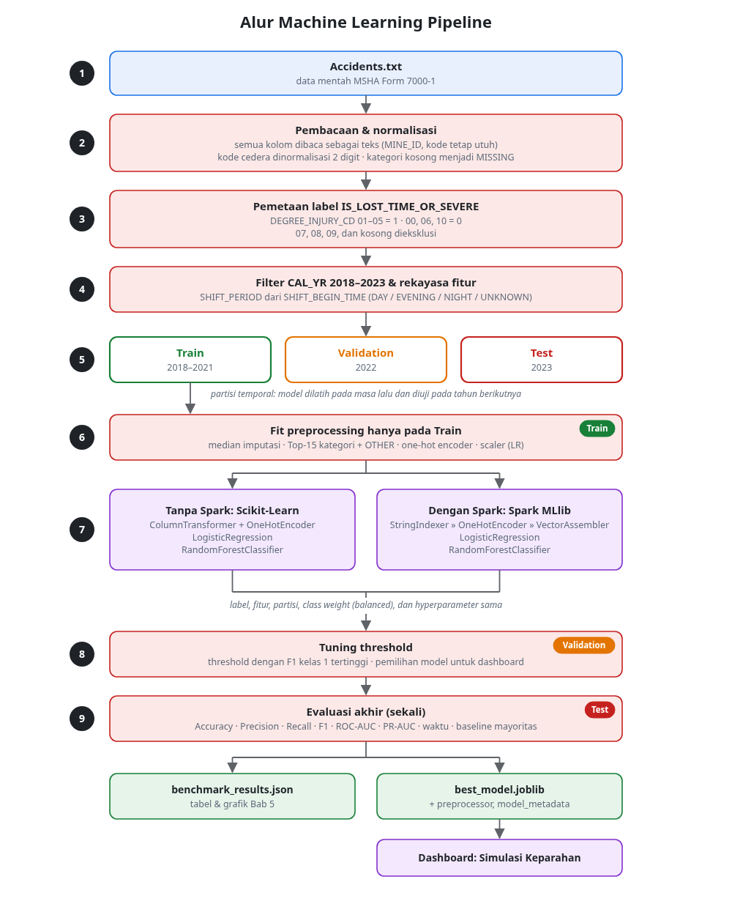
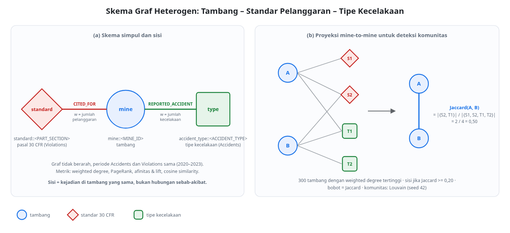

<!--
CATATAN PENYUSUNAN (HAPUS SEBELUM DIKUMPULKAN)

Penanda di dokumen ini:
  ⟦CEK⟧  = angka dari eksekusi pipeline versi lama. Cocokkan dengan output terbaru `python src/run_all.py`.
  ⟦ISI⟧  = angka atau gambar yang harus diisi dari artefak terbaru.
  ✍️ BAGIAN MAHASISWA = bagian yang menurut Ketentuan Penggunaan AI Assignment II wajib ditulis
     sendiri (alasan pemilihan, interpretasi hasil, perbandingan model, analisis graf, kesimpulan).
     Pertanyaan pemandu di bawahnya hanya membantu menyusun argumen; tidak berisi jawaban.

Daftar Isi, Daftar Gambar, dan Daftar Tabel dibuat otomatis di Word/Google Docs
(gunakan Heading 1–3 untuk judul bab dan sub-bab, serta Caption untuk gambar dan tabel).
Batas maksimal laporan: 40 halaman.
-->

# Assignment II Big Data Analytics

**Klasifikasi Tingkat Keparahan Cedera pada Insiden Tambang yang Dilaporkan dan Analisis Jaringan Tambang–Standar Pelanggaran–Tipe Kecelakaan Menggunakan Machine Learning dan Graph Analytics**

EMMANUEL CANDRA SULISTIAWAN
2702715744

GRADUATE PROGRAM
MASTER OF COMPUTER SCIENCE
BINA NUSANTARA UNIVERSITY
2026

- Link Video: ⟦ISI⟧
- Link PPT: ⟦ISI⟧
- Link Dataset: https://arlweb.msha.gov/opengovernmentdata/ogimsha.asp
- Link Source Code: https://github.com/Ngeces/big_data_mining_accident_analysis
- Link Notebook (eksekusi): ⟦ISI: link Colab yang sudah dijalankan⟧

---

## DAFTAR ISI

*(dibuat otomatis)*

## DAFTAR GAMBAR

- Gambar 2.1 Arsitektur solusi Big Data lokal berbasis Hadoop HDFS dan Apache Spark
- Gambar 4.1 Tren tahunan laporan kecelakaan MSHA 2010–2023
- Gambar 4.2 Model data relasional MSHA
- Gambar 5.1 Alur machine learning pipeline
- Gambar 5.2 Perbandingan metrik evaluasi pada test set
- Gambar 5.3 Confusion matrix model terpilih
- Gambar 5.4 Waktu komputasi Scikit-Learn vs Spark MLlib
- Gambar 6.1 Skema graf heterogen
- Gambar 6.2 Visualisasi jaringan tambang, standar, dan tipe kecelakaan
- Gambar 6.3 Sentralitas simpul (weighted degree dan PageRank)
- Gambar 6.4 Komunitas Louvain pada proyeksi mine-to-mine

## DAFTAR TABEL

- Tabel 2.1 Komponen arsitektur dan perannya
- Tabel 2.2 Ringkasan penyimpanan HDFS
- Tabel 2.3 Komponen pemrosesan
- Tabel 4.1 Ringkasan berkas dataset MSHA
- Tabel 4.2 Pemetaan kode DEGREE_INJURY_CD ke label biner
- Tabel 4.3 Ringkasan dataset untuk machine learning
- Tabel 5.1 Kolom yang dieksklusi dari prediktor
- Tabel 5.2 Fitur prediktor
- Tabel 5.3 Hyperparameter model
- Tabel 5.4 Padanan implementasi Scikit-Learn dan Spark MLlib
- Tabel 5.5 Hasil evaluasi pada test set 2023
- Tabel 5.6 Waktu komputasi
- Tabel 6.1 Tipe simpul dan sisi pada graf
- Tabel 6.2 Statistik graf
- Tabel 6.3 Simpul dengan weighted degree tertinggi

---

# BAB 1. PENDAHULUAN

## 1.1 Latar Belakang Masalah

Kebutuhan energi dunia terus meningkat. Perkembangan *Artificial Intelligence* (AI) mendorong pembangunan *data center* yang membutuhkan listrik dalam jumlah besar. Di saat yang sama, konflik di Timur Tengah mengganggu rantai pasokan minyak dan gas alam, termasuk melalui blokade Selat Hormuz. Banyak negara kemudian kembali mengandalkan batu bara karena biayanya rendah dan infrastrukturnya sudah tersedia.

Peningkatan produksi batu bara dan mineral berarti lebih banyak pekerja yang terpapar risiko kecelakaan tambang. Sektor batu bara memiliki tingkat kecelakaan dan dampak kesehatan yang lebih tinggi dibandingkan sumber energi rendah emisi (Markandya & Wilkinson, 2007). Di Amerika Serikat, setiap kecelakaan, cedera, dan penyakit akibat kerja di tambang wajib dilaporkan kepada Mine Safety and Health Administration (MSHA) melalui formulir MSHA 7000-1, sedangkan hasil inspeksi MSHA dicatat sebagai pelanggaran (*violations*) terhadap standar keselamatan 30 CFR. Pada tahun 2023 saja tercatat 6.093 laporan kecelakaan, dan 61,2% di antaranya berakhir dengan hari kerja hilang, pembatasan kerja, disabilitas, atau kematian ⟦CEK: `accident_annual_trend.csv`⟧.

Volume laporan tersebut menimbulkan dua masalah praktis:

1. **Prioritas tindak lanjut.** Laporan masuk setiap hari dari ribuan tambang. Petugas keselamatan perlu mengetahui sejak awal insiden mana yang kemungkinan besar berakhir sebagai cedera *lost-time* atau berat, berdasarkan informasi yang tersedia pada laporan (jenis kecelakaan, peralatan, aktivitas, pengalaman pekerja), agar investigasi dan penanganan dapat diprioritaskan.
2. **Pola antartambang.** Pelanggaran standar dan jenis kecelakaan tersimpan di tabel yang berbeda. Hubungan antara tambang, standar yang sering dilanggar, dan jenis kecelakaan yang sering terjadi sulit dilihat tanpa memodelkannya sebagai jaringan.

Data MSHA berukuran sekitar 2 GB dengan sekitar 4,6 juta baris, diperbarui setiap minggu, dan terdiri atas data terstruktur (kode, tanggal, angka) serta teks narasi. Karena itu, penelitian ini membangun solusi *Big Data* lokal berbasis Hadoop HDFS dan Apache Spark dengan tujuan:

1. Menyimpan data MSHA di HDFS dalam *raw zone* dan *curated zone* (Parquet terpartisi per tahun) yang dapat dikueri dengan Spark SQL.
2. Membangun model klasifikasi biner untuk memperkirakan apakah insiden yang dilaporkan tergolong *Lost-Time / Severe* (kode tingkat cedera 01–05), dengan dan tanpa Spark MLlib, lalu membandingkan kinerja dan waktu komputasinya.
3. Menganalisis graf tambang–standar pelanggaran–tipe kecelakaan untuk menemukan simpul dengan frekuensi tertinggi dan kelompok tambang dengan pola yang mirip.
4. Menyajikan hasilnya dalam dashboard Streamlit.

Model ini mengklasifikasikan insiden yang **sudah dilaporkan**. Model ini tidak memprediksi apakah kecelakaan akan terjadi.

## 1.2 Market and Business Driver

**Market driver**

- **Permintaan listrik *data center*.** Goldman Sachs Research memperkirakan permintaan listrik *data center* tumbuh sekitar 160% pada 2030 dibandingkan 2023 (Goldman Sachs, 2024). Sebagian kebutuhan ini dipenuhi pembangkit berbahan bakar fosil, termasuk batu bara (International Energy Agency, 2023, 2024), sehingga aktivitas penambangan dan jumlah pekerja yang terpapar risiko ikut bertambah.

**Business driver**

- **Manajemen risiko.** Cedera *lost-time* menghilangkan hari kerja dan menghambat produksi. Mengetahui lebih awal insiden mana yang berpotensi berat membantu perusahaan mengalokasikan investigasi dan penanganan medis.
- **Kepatuhan regulasi.** MSHA mengenakan sanksi atas pelanggaran standar keselamatan berdasarkan Federal Mine Safety and Health Act. Analisis standar yang paling sering dilanggar membantu operator memfokuskan perbaikan.
- **Biaya infrastruktur.** Hadoop dan Spark adalah perangkat lunak *open source* yang dapat dijalankan di satu komputer. Untuk data sekitar 2 GB, solusi lokal tidak memerlukan biaya layanan cloud, sementara teknologi dan kode yang sama tetap dapat dipindahkan ke klaster bila data bertambah.

## 1.3 Pemangku Kepentingan yang Terlibat

| Pemangku kepentingan | Kepentingan terhadap solusi |
|---|---|
| Petugas keselamatan (*safety officer*) perusahaan tambang | Memprioritaskan tindak lanjut insiden berdasarkan skor keparahan |
| Manajemen dan operator tambang | Memantau tren kecelakaan dan standar yang sering dilanggar untuk perencanaan perbaikan |
| Regulator keselamatan tambang (MSHA) dan inspektur | Melihat tambang dan standar dengan frekuensi pelanggaran serta kecelakaan tertinggi |
| Perusahaan pembangkit listrik dan pemilik *data center* | Menilai risiko keselamatan pada rantai pasok energi |
| Dinas sosial dan instansi ketenagakerjaan | Mengantisipasi dampak cedera berat dan kematian terhadap pekerja dan keluarganya |

---

# BAB 2. RANCANGAN SOLUSI BIG DATA

Assignment I mengusulkan arsitektur berbasis layanan cloud AWS. Pada Assignment II, rancangan tersebut diganti seluruhnya dengan arsitektur lokal: Hadoop HDFS mode *pseudo-distributed* (NameNode dan DataNode berjalan di satu mesin) sebagai penyimpanan dan Apache Spark mode `local[*]` sebagai pemrosesan. Alasan perubahan:

- Ukuran data (±2 GB) dapat diproses di satu mesin, sehingga klaster cloud belum diperlukan.
- Tidak ada biaya layanan dan tidak memerlukan akun cloud.
- HDFS dan Spark adalah teknologi yang sama dengan yang dipakai pada klaster Hadoop, sehingga konsep penyimpanan terdistribusi, partisi, dan pemrosesan paralel tetap diterapkan, dan kode dapat dipindahkan ke klaster dengan mengganti alamat HDFS dan *master* Spark.

<!-- ✍️ Periksa alasan di atas dan sesuaikan dengan alasan Anda sendiri memilih solusi lokal. -->



*Gambar 2.1 Arsitektur solusi Big Data lokal berbasis Hadoop HDFS dan Apache Spark.*

*Tabel 2.1 Komponen arsitektur dan perannya*

| Lapisan | Komponen | Lokasi | Peran |
|---|---|---|---|
| Ingestion | Skrip Python (downloader) | Mesin lokal | Mengunduh dan mengekstrak berkas MSHA setiap rilis mingguan |
| Landing zone | Folder `data/` | Disk lokal | Tempat berkas `.txt` hasil unduhan sebelum diunggah ke HDFS |
| Raw zone | HDFS `/user/msha/raw/` | HDFS | Salinan berkas asli MSHA (Accidents, Violations, Mines) tanpa perubahan |
| Curated zone | HDFS `/user/msha/warehouse/msha_accidents/` | HDFS | Accidents dalam Parquet + Snappy, partisi `CAL_YR=YYYY` |
| Processed zone | `data/processed/{train,val,test}.csv` | Disk lokal | Partisi data untuk machine learning |
| Pemrosesan | Spark SQL, Spark MLlib, pandas, Scikit-Learn, NetworkX | Mesin lokal | Konversi, kueri, pemodelan, dan graph analytics |
| Artifacts | Folder `artifacts/` | Disk lokal | Model, metrik, hasil graf, dan ringkasan HDFS |
| Visualisasi | Streamlit | Mesin lokal | Dashboard yang hanya membaca artifacts |

## 2.1 Metode Pengumpulan Data

Data diperoleh dari MSHA Open Government Data (U.S. Department of Labor). Menurut dokumentasi MSHA, dataset diperbarui setiap minggu dan disediakan sebagai berkas utuh berformat `.txt` dengan pemisah `|`, bukan sebagai aliran data (*data stream*). Karena itu, pengumpulan data menggunakan *weekly batch ingestion* dengan metode *full refresh*: setiap rilis menggantikan seluruh isi berkas sebelumnya.

Alur pengumpulan data:

1. **Unduh dan ekstrak.** Skrip Python mengunduh arsip `.zip` dari server MSHA dan mengekstrak berkas `.txt` ke *landing zone* (`data/`).
2. **Unggah ke HDFS.** Modul `src/hadoop_storage.py` menyalin Accidents.txt, Violations.txt, dan Mines.txt ke *raw zone* HDFS melalui Hadoop FileSystem API (`copyFromLocalFile` dengan opsi *overwrite*). Opsi *overwrite* menerapkan *full refresh*: berkas lama di HDFS diganti dengan rilis terbaru.
3. **Pembacaan dengan aturan parsing yang ketat.** Spark membaca berkas dari HDFS dengan pemisah `|`, *encoding* Latin-1, karakter kutip `"`, dan seluruh kolom sebagai teks (`inferSchema=False`). Pembacaan sebagai teks mencegah hilangnya angka nol di depan pada `MINE_ID` dan kode MSHA (misalnya `01`). Kolom numerik kemudian dikonversi secara eksplisit.

Eksplorasi pada Assignment I menemukan bahwa kolom teks bebas `NARRATIVE` dapat mengandung karakter pemisah atau baris baru yang menggeser kolom (*column shifting*). Kolom tersebut tidak dipakai sebagai fitur pada pipeline machine learning.

## 2.2 Teknologi Penyimpanan Data

Penyimpanan utama menggunakan **Hadoop Distributed File System (HDFS)**. HDFS menyimpan berkas sebagai blok berukuran besar (bawaan 128 MB) yang tersebar di DataNode, sedangkan NameNode menyimpan metadata, yaitu struktur direktori dan lokasi setiap blok (Shvachko et al., 2010). Pada mode *pseudo-distributed*, NameNode dan DataNode berjalan sebagai proses terpisah di satu mesin, dengan `fs.defaultFS = hdfs://localhost:9000` dan `dfs.replication = 1` karena hanya ada satu DataNode.

Data dibagi ke dalam zona sesuai fungsinya:

- **Raw zone (`/user/msha/raw/`).** Menyimpan berkas asli MSHA tanpa perubahan, sehingga setiap tahap pemrosesan dapat diulang dari sumber yang sama.
- **Curated zone (`/user/msha/warehouse/msha_accidents/`).** Spark mengonversi Accidents.txt ke **Apache Parquet** dengan kompresi **Snappy** dan mempartisinya per tahun kalender (`CAL_YR=YYYY`). Parquet menyimpan data per kolom, sehingga kueri hanya membaca kolom yang diperlukan. Partisi per tahun memungkinkan *partition pruning*: kueri dengan filter `CAL_YR` hanya membaca direktori tahun yang relevan.
- **Processed zone dan artifacts (disk lokal).** Partisi *training*, *validation*, dan *test* serta artefak model berukuran kecil dan dibaca oleh pandas, Scikit-Learn, dan Streamlit, sehingga disimpan di disk lokal.

Hasil pengukuran pada HDFS (sumber: `artifacts/hadoop_storage_summary.json`):

*Tabel 2.2 Ringkasan penyimpanan HDFS*

| Ukuran | Nilai |
|---|---|
| Filesystem | ⟦ISI: `filesystem_uri`, harus `hdfs://localhost:9000`⟧ |
| Block size / replication | ⟦ISI: `block_size_mb`⟧ MB / ⟦ISI: `replication_factor`⟧ |
| Ukuran raw zone (3 berkas) | ⟦ISI: `raw_zone_total_mb`⟧ MB |
| Accidents.txt (raw) | ⟦ISI: `raw_csv_size_mb`⟧ MB |
| Accidents Parquet (curated) | ⟦ISI: `hadoop_parquet_size_mb`⟧ MB (lebih kecil ⟦ISI: `storage_savings_pct`⟧%) |
| Jumlah partisi tahun | ⟦ISI: `num_partitions`⟧ |
| Waktu unggah / tulis Parquet / kueri | ⟦ISI⟧ s / ⟦ISI⟧ s / ⟦ISI⟧ s |

## 2.3 Processing Framework

Pemrosesan menggunakan **Apache Spark** (PySpark) dalam mode `local[*]`, yaitu Spark memakai seluruh inti CPU pada satu mesin sebagai *executor*. Spark dikonfigurasi dengan `fs.defaultFS` yang menunjuk ke HDFS, sehingga membaca dan menulis data langsung ke HDFS.

Spark dipilih karena memproses data secara *in-memory* dengan *Resilient Distributed Dataset* (RDD) dan DataFrame (Zaharia et al., 2016). Hadoop MapReduce menulis hasil antara ke disk pada setiap tahap Map dan Reduce, sedangkan Spark menyimpan hasil antara di memori dan baru menulis ke disk (*spill to disk*) bila memori tidak cukup.

*Tabel 2.3 Komponen pemrosesan*

| Komponen | Sumber data | Fungsi |
|---|---|---|
| Spark SQL | HDFS raw zone → curated zone | Konversi ke Parquet dan kueri agregasi per tahun |
| pandas | Landing zone | Pembersihan data, pemetaan label, dan partisi temporal (Bab 5) |
| Spark MLlib | Processed zone | Logistic Regression dan Random Forest terdistribusi (Bab 5) |
| Scikit-Learn | Processed zone | Model pembanding tanpa Spark (Bab 5) |
| NetworkX | Landing zone (Accidents, Violations) | Pembentukan graf, sentralitas, dan komunitas (Bab 6) |
| Streamlit | Artifacts | Dashboard interaktif |

Modul pandas, Scikit-Learn, dan NetworkX membaca salinan berkas di *landing zone*, yang isinya sama dengan *raw zone* HDFS. Spark membaca dan menulis langsung ke HDFS.

---

# BAB 3. TATA KELOLA IT

## 3.1 Security

Perubahan data oleh pihak yang tidak berwenang dapat memengaruhi hasil model. Pengamanan yang diterapkan pada solusi lokal:

- **Hak akses HDFS.** HDFS memakai model izin seperti POSIX (pemilik, grup, dan lainnya). Direktori `/user/msha/raw` dimiliki oleh pengguna yang menjalankan ingestion dan diberi izin `755`, sehingga hanya pemilik yang dapat menulis dan pengguna lain hanya dapat membaca (`hdfs dfs -chmod -R 755 /user/msha/raw`).
- **Akses jaringan terbatas.** NameNode hanya mendengarkan di `localhost:9000` dan dashboard Streamlit berjalan di mesin lokal, sehingga keduanya tidak dapat diakses dari jaringan lain.
- **Batasan autentikasi.** Mode *pseudo-distributed* memakai autentikasi sederhana (*simple authentication*) yang memercayai nama pengguna sistem operasi. Untuk klaster dengan banyak pengguna, HDFS perlu dikonfigurasi dengan Kerberos.
- **Verifikasi sumber.** Hasil olahan dapat diverifikasi dengan mengunduh ulang berkas dari situs MSHA, karena *raw zone* tidak pernah diubah.
- **Pengelolaan rahasia.** Kunci API dan kredensial tidak ditulis di kode sumber atau disimpan di repository; nilai tersebut dibaca dari variabel lingkungan atau `st.secrets`.

## 3.2 Compliance

Dataset MSHA merupakan data pemerintah Amerika Serikat yang dipublikasikan sebagai data terbuka dan bebas digunakan untuk analisis. Seluruh data disimpan dan diproses di mesin lokal dan tidak dikirim ke layanan pihak ketiga. Sumber, tanggal unduh, dan periode data dicatat dalam laporan agar hasil dapat direproduksi, karena MSHA memperbarui berkas setiap minggu.

## 3.3 Data Privacy

Dataset merupakan data publik dan tidak memuat nama pekerja. Meskipun demikian, kolom narasi (`NARRATIVE`) tidak dipakai sebagai fitur dan tidak ditampilkan di dashboard, dan dashboard hanya menampilkan data agregat per tambang.

## 3.4 Data Quality

Data merupakan laporan kecelakaan, sehingga tidak setiap hari memiliki laporan dan sebagian kolom tidak selalu terisi. Penanganan kualitas data yang diterapkan:

| Masalah | Penanganan |
|---|---|
| Integritas berkas di HDFS | HDFS menyimpan *checksum* untuk setiap blok dan memeriksanya saat data dibaca. Dengan *replication factor* 1, blok yang rusak tidak dapat dipulihkan dari replika, sehingga pemulihan dilakukan dengan mengunggah ulang berkas dari MSHA |
| Sel kosong pada fitur kategorikal | Diberi label `MISSING` |
| Penanda MSHA untuk nilai tidak diketahui (`?`, `NO VALUE FOUND`) | Pada label: dieksklusi. Pada fitur: dipertahankan sebagai kategori tersendiri. Pada graf: tipe kecelakaan dan standar dengan penanda ini dibuang |
| Angka nol di depan pada `MINE_ID` dan kode MSHA | Seluruh kolom dibaca sebagai teks; kode cedera dinormalisasi menjadi dua digit (`1` → `01`) |
| Nilai kosong pada fitur numerik pengalaman kerja | Diisi median yang dihitung **hanya dari data training** |
| Kategori dengan jumlah sangat banyak (peralatan, aktivitas) | 15 kategori terbanyak pada data training dipertahankan, sisanya digabung menjadi `OTHER` |
| Kode cedera di luar cakupan (07, 08, 09) atau kosong | Dieksklusi dan jumlahnya dicatat (Tabel 4.2) |
| Baris tanpa `CAL_YR` valid | Tidak ditulis ke curated zone; jumlahnya dicatat di `hadoop_storage_summary.json` |
| Pergeseran kolom akibat teks bebas | Dideteksi pada notebook eksplorasi; kolom `NARRATIVE` tidak dipakai pada pipeline machine learning |
| Waktu shift berformat HHMM yang tidak valid | Dikategorikan sebagai `UNKNOWN` |

Kode eksplorasi kualitas data: https://colab.research.google.com/drive/1IKOqwyx-5LudkYKyRNBlRFOzULQMKCMS?usp=sharing

---

# BAB 4. DATA

## 4.1 Deskripsi Data

Data diperoleh dari portal data terbuka U.S. Department of Labor (MSHA). Penelitian ini menggunakan empat berkas `.txt`:

*Tabel 4.1 Ringkasan berkas dataset MSHA*

| Berkas | Ukuran | Isi |
|---|---|---|
| Mines.txt | 37,55 MB | Profil tambang: lokasi, status, jenis tambang, operator, koordinat |
| Accidents.txt | 218,08 MB | Laporan kecelakaan, cedera, dan penyakit (MSHA Form 7000-1): waktu, lokasi, peralatan, aktivitas, tingkat cedera, narasi kejadian |
| Inspections.txt | 331,97 MB | Laporan inspeksi oleh MSHA |
| Violations.txt | 1.375,41 MB | Pelanggaran standar keselamatan yang ditemukan pada inspeksi |

Data sebagian besar berbentuk tabel terstruktur, dengan satu kolom tidak terstruktur yaitu narasi kecelakaan.

**Karakteristik 5V**

- **Volume:** sekitar 2 GB dengan sekitar 4,6 juta baris.
- **Variety:** tanggal, lokasi dan koordinat, kode kategori, angka pengukuran (pengalaman kerja, hari kerja hilang), dan teks narasi.
- **Velocity:** tidak *real-time*, tetapi data baru dirilis setiap minggu.
- **Value:** data dapat digunakan untuk memahami pola kecelakaan, tingkat keparahan cedera, dan pelanggaran yang ditemukan pada inspeksi.
- **Veracity:** tingkat nilai kosong berbeda antar kolom (hasil profiling pada notebook Assignment I), dan beberapa kolom memakai penanda khusus seperti `?` atau `NO VALUE FOUND` untuk nilai yang tidak diketahui.

Gambar 4.1 menunjukkan jumlah laporan kecelakaan per tahun pada 2010–2023.

⟦ISI: tangkapan layar grafik "Tren tahunan laporan kecelakaan" dari halaman Overview dashboard⟧

*Gambar 4.1 Tren tahunan laporan kecelakaan MSHA 2010–2023*

## 4.2 Model Data

Data terstruktur disimpan sebagai tabel relasional. Relasi antartabel:

- `MINE_ID` terdapat pada keempat tabel dan menghubungkan kecelakaan, inspeksi, dan pelanggaran dengan profil tambang.
- Inspections dan Violations dihubungkan melalui `EVENT_NO`.
- Narasi kecelakaan (data tidak terstruktur) tetap terhubung ke data terstruktur melalui `DOCUMENT_NO`.



*Gambar 4.2 Model data relasional MSHA*

Untuk Graph Analytics (Bab 6), relasi tersebut juga dimodelkan sebagai graf: tambang, standar yang dilanggar, dan tipe kecelakaan menjadi simpul, sedangkan frekuensi kejadian menjadi bobot sisi.

## 4.3 Dataset untuk Diolah Menggunakan Machine Learning

**Data yang dipilih.** Machine learning menggunakan berkas **Accidents.txt** (data terstruktur). Graph Analytics menggunakan Accidents.txt dan Violations.txt, sedangkan Mines.txt dipakai untuk koordinat dan atribut tambang di dashboard.

**Unit data.** Satu baris adalah satu laporan insiden (satu formulir MSHA 7000-1).

**Label.** Target biner `IS_LOST_TIME_OR_SEVERE` dibentuk dari kolom `DEGREE_INJURY_CD`:

*Tabel 4.2 Pemetaan kode DEGREE_INJURY_CD ke label biner*

| Kode | Deskripsi MSHA | Label | Jumlah baris (seluruh data) |
|---|---|---|---|
| 01 | Fatality | 1 | ⟦ISI⟧ |
| 02 | Permanent total or permanent partial disability | 1 | ⟦ISI⟧ |
| 03 | Days away from work only | 1 | ⟦ISI⟧ |
| 04 | Days away from work and restricted activity | 1 | ⟦ISI⟧ |
| 05 | Days restricted activity only | 1 | ⟦ISI⟧ |
| 00 | Accident only | 0 | ⟦ISI⟧ |
| 06 | No days away from work, no restrictions | 0 | ⟦ISI⟧ |
| 10 | All other cases (termasuk *first aid*) | 0 | ⟦ISI⟧ |
| 07 | Occupational illness not degree 1–6 | Dieksklusi | ⟦ISI⟧ |
| 08 | Injuries due to natural causes | Dieksklusi | ⟦ISI⟧ |
| 09 | Injuries involving non-employees | Dieksklusi | ⟦ISI⟧ |
| kosong / `?` | Tidak ada nilai | Dieksklusi | ⟦ISI⟧ |

*Sumber jumlah baris: `label_profile_raw` pada `artifacts/preprocessing_metadata.json`. Cocokkan deskripsi kode dengan `Accidents_Definition_File.txt` dari MSHA.*

**Periode dan partisi.** Data dibatasi pada tahun kalender 2018–2023 dan dibagi secara temporal:

*Tabel 4.3 Ringkasan dataset untuk machine learning*

| Partisi | Periode | Jumlah baris | Proporsi label 1 | Fungsi |
|---|---|---|---|---|
| Training | 2018–2021 | 23.484 ⟦CEK⟧ | ⟦ISI⟧ | Fit preprocessing dan model |
| Validation | 2022 | 5.682 ⟦CEK⟧ | ⟦ISI⟧ | Pemilihan model dan *threshold* |
| Test | 2023 | 5.765 ⟦CEK⟧ | ⟦ISI⟧ | Evaluasi akhir (sekali) |
| **Total** | 2018–2023 | 34.931 ⟦CEK⟧ | ⟦ISI⟧ | |

*Sumber: `split` pada `artifacts/preprocessing_metadata.json`.*

> ✍️ **BAGIAN MAHASISWA — Deskripsi masalah dan alasan pemilihan data**
>
> Tuliskan dengan kata-kata Anda sendiri:
> - Masalah apa yang diselesaikan, dan mengapa ini klasifikasi keparahan **setelah insiden dilaporkan**, bukan prediksi apakah kecelakaan akan terjadi.
> - Mengapa Anda memilih Accidents.txt untuk machine learning.
> - Mengapa kode 05 (*restricted activity only*) Anda masukkan ke label 1, dan mengapa kode 07, 08, 09 dieksklusi.
> - Mengapa Anda memilih periode 2018–2023 dan pembagian temporal, bukan pembagian acak.

---

# BAB 5. MACHINE LEARNING UNTUK BIG DATA

Gambar 5.1 menunjukkan alur pipeline yang diimplementasikan. Kode sumber berada di folder `src/` pada repository, dan seluruh tahap dapat dijalankan dengan `python src/run_all.py`.



*Gambar 5.1 Alur machine learning pipeline*

## 5.1 Data Preprocessing

Preprocessing diimplementasikan di `src/data_pipeline.py`:

1. **Pembacaan.** Hanya kolom yang diperlukan dibaca, seluruhnya sebagai teks. Spasi dan tanda kutip dibuang, dan string kosong diubah menjadi nilai kosong.
2. **Normalisasi kode cedera.** `DEGREE_INJURY_CD` dinormalisasi menjadi dua digit, lalu distribusi seluruh kode dicatat (Tabel 4.2).
3. **Pembentukan label dan eksklusi.** Baris dengan kode 01–05 diberi label 1, kode 00, 06, dan 10 diberi label 0, dan baris lainnya dieksklusi.
4. **Filter periode.** Hanya baris dengan `CAL_YR` 2018–2023 yang digunakan.
5. **Pembersihan fitur.** Nilai kategorikal yang kosong diberi label `MISSING`. Nilai pengalaman kerja diubah menjadi angka; nilai yang tidak valid menjadi kosong.
6. **Partisi temporal.** Data dibagi menjadi training (2018–2021), validation (2022), dan test (2023).
7. **Fit hanya pada training.** Median pengalaman kerja dan daftar 15 kategori terbanyak dihitung dari data training saja, lalu diterapkan ke ketiga partisi. Dengan cara ini, informasi dari tahun 2022 dan 2023 tidak bocor ke proses training.
8. **Penyimpanan.** Ketiga partisi disimpan sebagai CSV, dan parameter preprocessing disimpan di `preprocessing_metadata.json`.

**Pencegahan target leakage.** Kolom yang nilainya ditentukan oleh tingkat cedera atau baru diketahui setelah penanganan medis tidak dibaca sama sekali sebagai prediktor:

*Tabel 5.1 Kolom yang dieksklusi dari prediktor*

| Kolom | Alasan eksklusi |
|---|---|
| `DEGREE_INJURY_CD`, `DEGREE_INJURY` | Sumber label |
| `DAYS_LOST`, `DAYS_RESTRICT`, `SCHEDULE_CHARGE` | Dihitung dari tingkat cedera |
| `RETURN_TO_WORK_DT`, `TRANS_TERM`, `CLOSED_DOC_NO` | Baru diketahui setelah kasus ditutup |
| `INVEST_BEGIN_DT`, `IMMED_NOTIFY_CD`, `IMMED_NOTIFY` | Tindak lanjut yang bergantung pada keparahan |
| `NATURE_INJURY`, `INJ_BODY_PART`, `INJURY_SOURCE` (dan kodenya) | Diagnosis klinis setelah kejadian |
| `NARRATIVE` | Teks bebas yang sering menyebut hasil cedera |

## 5.2 Feature Engineering

*Tabel 5.2 Fitur prediktor*

| Fitur | Tipe | Transformasi |
|---|---|---|
| `SUBUNIT` | Kategorikal | One-hot encoding |
| `COAL_METAL_IND` | Kategorikal | One-hot encoding |
| `ACCIDENT_TYPE` | Kategorikal | One-hot encoding |
| `MINING_EQUIP` | Kategorikal | Top-15 dari training + `OTHER`, lalu one-hot |
| `ACTIVITY` | Kategorikal | Top-15 dari training + `OTHER`, lalu one-hot |
| `SHIFT_PERIOD` | Kategorikal (turunan) | Dari `SHIFT_BEGIN_TIME` (HHMM): DAY 06–14, EVENING 14–22, NIGHT 22–06, UNKNOWN |
| `TOT_EXPER` | Numerik | Imputasi median training; standardisasi untuk LR |
| `MINE_EXPER` | Numerik | Imputasi median training; standardisasi untuk LR |
| `JOB_EXPER` | Numerik | Imputasi median training; standardisasi untuk LR |

Detail implementasi:

- **One-hot encoding** mempertahankan semua kategori yang dilihat pada training. Kategori baru pada validation atau test diubah menjadi vektor nol (`handle_unknown="ignore"` di Scikit-Learn dan `handleInvalid="keep"` + `dropLast=True` di Spark).
- **Standardisasi** (rata-rata 0, simpangan baku 1) hanya diterapkan pada fitur numerik untuk Logistic Regression. Random Forest tidak memerlukan standardisasi karena pemisahan pada pohon keputusan tidak bergantung pada skala.
- **Ketidakseimbangan kelas** ditangani dengan *class weight* "balanced": bobot kelas *c* = jumlah baris training / (2 × jumlah baris kelas *c*). Rumus yang sama dipakai di kedua framework.

> ✍️ **BAGIAN MAHASISWA — Alasan feature engineering**
>
> Jelaskan alasan Anda untuk:
> - Pemilihan setiap fitur, terutama mengapa peralatan (`MINING_EQUIP`) dan aktivitas dipakai.
> - Pembatasan Top-15 kategori dan penggabungan `OTHER`.
> - Pembagian shift menjadi DAY, EVENING, dan NIGHT dengan batas jam tersebut.
> - Penggunaan median untuk imputasi.
> - Penggunaan *class weight*, bukan *oversampling* atau *undersampling*.

## 5.3 Algoritma Machine Learning

Dua algoritma klasifikasi biner digunakan, masing-masing diimplementasikan di Scikit-Learn dan Spark MLlib.

**Logistic Regression.** Model linier yang memodelkan peluang label 1 sebagai *p* = σ(**w**·**x** + *b*), dengan σ fungsi sigmoid. Parameter dipelajari dengan meminimalkan *log-loss* berbobot ditambah regularisasi L2. Koefisien **w** dapat dibaca langsung sebagai arah dan besar pengaruh setiap fitur.

**Random Forest.** *Ensemble* dari banyak pohon keputusan (Breiman, 2001). Setiap pohon dilatih pada sampel *bootstrap* dan pada setiap pemisahan hanya mempertimbangkan subset acak fitur (√jumlah fitur). Prediksi adalah rata-rata peluang dari seluruh pohon. Random Forest dapat menangkap interaksi antarfitur yang tidak linier.

*Tabel 5.3 Hyperparameter model (sama untuk kedua framework, diatur di `src/config.py`)*

| Model | Hyperparameter | Nilai |
|---|---|---|
| Logistic Regression | Regularisasi | L2, C = 1,0 (Spark: `regParam` = 1 / (C × jumlah bobot training)) |
| Logistic Regression | Iterasi maksimum | 1.000 |
| Random Forest | Jumlah pohon | 100 |
| Random Forest | Kedalaman maksimum | 15 |
| Random Forest | Fitur per pemisahan | √jumlah fitur |
| Keduanya | *Class weight* | balanced |
| Keduanya | *Random seed* | 42 |
| Keduanya | Grid *threshold* | 0,05–0,95 dengan langkah 0,01 |

> ✍️ **BAGIAN MAHASISWA — Alasan pemilihan algoritma**
>
> Jelaskan mengapa Anda memilih Logistic Regression dan Random Forest untuk masalah ini, apa kelebihan dan kekurangan masing-masing terhadap karakteristik data Anda, dan mengapa nilai hyperparameter pada Tabel 5.3 dipilih.

## 5.4 Proses Pengembangan Model dengan dan tanpa Spark MLlib

**Tanpa Spark (Scikit-Learn) — `src/models_baseline.py`**

1. Partisi training, validation, dan test dibaca dengan pandas.
2. `ColumnTransformer` menggabungkan `OneHotEncoder` untuk fitur kategorikal dan `StandardScaler` (khusus LR) untuk fitur numerik. Transformer di-fit pada training, lalu diterapkan ke validation dan test.
3. `LogisticRegression` dan `RandomForestClassifier` dilatih pada training. Waktu fit diukur.
4. Peluang pada validation dihitung, lalu *threshold* dengan F1 kelas 1 tertinggi dipilih.
5. Model dengan F1 validation tertinggi disimpan sebagai model dashboard (`best_model.joblib`, `preprocessor.joblib`, `model_metadata.json`).
6. Peluang pada test dihitung sekali dan dievaluasi dengan *threshold* hasil langkah 4. Waktu inferensi diukur.

**Dengan Spark MLlib — `src/models_spark.py`**

1. `SparkSession` dibuat dalam mode `local[*]` (memori driver 4 GB).
2. Partisi yang sama dibaca sebagai Spark DataFrame tanpa inferensi skema; kolom numerik di-*cast* secara eksplisit.
3. Kolom `classWeight` ditambahkan pada training dengan rumus *balanced*.
4. Spark ML `Pipeline` berisi `StringIndexer`, `OneHotEncoder`, `VectorAssembler`, dan `StandardScaler` (hanya untuk fitur numerik LR). Pipeline di-fit pada training.
5. `LogisticRegression` dan `RandomForestClassifier` dari `pyspark.ml.classification` dilatih dengan `weightCol="classWeight"`. Data training di-*cache* di memori sebelum training.
6. Kolom `probability` diubah menjadi array; peluang kelas 1 pada validation dan test diambil, lalu *threshold* dipilih dan metrik dihitung dengan fungsi yang sama seperti Scikit-Learn (`src/evaluation.py`).

*Tabel 5.4 Padanan implementasi Scikit-Learn dan Spark MLlib*

| Aspek | Scikit-Learn | Spark MLlib |
|---|---|---|
| Struktur data | pandas DataFrame / sparse matrix | Spark DataFrame (terdistribusi, *lazy*) |
| Encoding kategorikal | `OneHotEncoder(handle_unknown="ignore")` | `StringIndexer(handleInvalid="keep")` + `OneHotEncoder(dropLast=True)` |
| Penggabungan fitur | `ColumnTransformer` | `VectorAssembler` |
| Standardisasi (LR) | `StandardScaler` pada numerik | `StandardScaler(withMean=True)` pada numerik |
| Class weight | `class_weight="balanced"` | `weightCol` dengan rumus yang sama |
| Eksekusi | Satu proses (RF memakai semua inti via `n_jobs=-1`) | Tugas dibagi ke *executor* (di sini semua inti lokal) |
| Pemilihan *threshold* | Validation set | Validation set |
| Perhitungan metrik | `src/evaluation.py` | `src/evaluation.py` |

**Pengukuran waktu.** *Fit time* adalah waktu `fit()` model saja. Waktu inisialisasi `SparkSession` dan fit pipeline preprocessing Spark dicatat terpisah (`Spark_Init_Seconds`, `Preprocess_Fit_Seconds`). *Inference time* adalah waktu menghasilkan prediksi untuk seluruh test set.

**Lingkungan eksekusi:** ⟦ISI: CPU, RAM, sistem operasi, versi Python, Java, Hadoop, PySpark, Scikit-Learn⟧.

## 5.5 Evaluasi Model

Kelas positif adalah label 1 (Lost-Time / Severe). Dengan TP, FP, TN, dan FN dari *confusion matrix*:

- **Accuracy** = (TP + TN) / total.
- **Precision (kelas 1)** = TP / (TP + FP): dari insiden yang diprediksi Lost-Time / Severe, berapa yang benar.
- **Recall (kelas 1)** = TP / (TP + FN): dari insiden Lost-Time / Severe, berapa yang terdeteksi.
- **F1 (kelas 1)** = 2 × Precision × Recall / (Precision + Recall).
- **F1 Macro**: rata-rata F1 kelas 0 dan kelas 1.
- **ROC-AUC**: luas area di bawah kurva TPR terhadap FPR untuk semua *threshold*; tidak bergantung pada *threshold* yang dipilih.
- **PR-AUC** (*average precision*): luas area di bawah kurva Precision–Recall. Nilai acuan model acak sama dengan proporsi kelas 1 pada test set (Saito & Rehmsmeier, 2015).

Sebagai pembanding minimum, digunakan **baseline kelas mayoritas** yang selalu memprediksi kelas terbanyak pada training.

*Tabel 5.5 Hasil evaluasi pada test set 2023 (sumber: `artifacts/benchmark_results.json`)*

| Model | Threshold | Val F1 | Accuracy | Precision (C1) | Recall (C1) | F1 (C1) | F1 Macro | ROC-AUC | PR-AUC |
|---|---|---|---|---|---|---|---|---|---|
| Baseline kelas mayoritas | – | – | 0,6467 | 0,6467 | 1,0000 | 0,7854 | 0,3927 | 0,5000 | 0,6467 |
| Scikit-Learn Logistic Regression | 0,32 | 0,8317 | 0,7641 | 0,7608 | 0,9265 | 0,8355 | 0,7093 | 0,8153 | 0,8703 |
| Scikit-Learn Random Forest | 0,39 | 0,8316 | 0,7617 | 0,7519 | 0,9423 | 0,8364 | 0,6987 | 0,8141 | 0,8718 |
| Spark MLlib Logistic Regression | 0,32 | 0,8315 | 0,7643 | 0,7608 | 0,9268 | 0,8357 | 0,7095 | 0,8152 | 0,8702 |
| Spark MLlib Random Forest | 0,37 | 0,8321 | 0,7613 | 0,7488 | 0,9493 | 0,8372 | 0,6950 | 0,8157 | 0,8749 |

*Tabel 5.6 Waktu komputasi (detik)*

| Model | Fit | Inferensi test | Inisialisasi Spark | Fit preprocessing Spark |
|---|---|---|---|---|
| Scikit-Learn Logistic Regression | ⟦ISI⟧ | ⟦ISI⟧ | – | – |
| Scikit-Learn Random Forest | ⟦ISI⟧ | ⟦ISI⟧ | – | – |
| Spark MLlib Logistic Regression | ⟦ISI⟧ | ⟦ISI⟧ | ⟦ISI⟧ | ⟦ISI⟧ |
| Spark MLlib Random Forest | ⟦ISI⟧ | ⟦ISI⟧ | ⟦ISI⟧ | ⟦ISI⟧ |

⟦ISI: tangkapan layar halaman Benchmark, tab Metrik⟧

*Gambar 5.2 Perbandingan metrik evaluasi pada test set*

⟦ISI: tangkapan layar tab Confusion matrix untuk model terpilih⟧

*Gambar 5.3 Confusion matrix model terpilih*

⟦ISI: tangkapan layar tab Waktu komputasi⟧

*Gambar 5.4 Waktu komputasi Scikit-Learn vs Spark MLlib*

**Model untuk dashboard.** Model yang dipakai di halaman Simulasi Keparahan adalah ⟦ISI: `model_name` dari `model_metadata.json`⟧ dengan *threshold* ⟦ISI⟧, dipilih berdasarkan F1 kelas 1 pada validation set.

## 5.6 Analisis

> ✍️ **BAGIAN MAHASISWA — Interpretasi dan perbandingan model**
>
> Bagian ini wajib ditulis sendiri. Pertanyaan pemandu:
> - Bandingkan setiap model dengan baseline kelas mayoritas pada Tabel 5.5. Metrik mana yang paling relevan untuk masalah ini, dan mengapa?
> - Apa arti *threshold* yang terpilih terhadap keseimbangan precision dan recall? Apa konsekuensi FN (insiden severe yang terlewat) dibandingkan FP dalam konteks keselamatan tambang?
> - Bagaimana perbedaan hasil Logistic Regression dan Random Forest? Apa kemungkinan penyebabnya?
> - Apakah hasil Scikit-Learn dan Spark MLlib untuk algoritma yang sama berbeda? Jika ya, faktor implementasi apa yang dapat menjelaskannya (lihat Tabel 5.4)?
> - Bagaimana Anda menjelaskan perbedaan waktu komputasi pada Tabel 5.6 untuk ukuran data ini, dan kapan Spark akan lebih menguntungkan?
> - Apa keterbatasan model ini (fitur yang tersedia, periode data, kemungkinan perubahan pola antartahun)?

---

# BAB 6. GRAPH ANALYTICS

## 6.1 Pengembangan Graph

Graph analytics diimplementasikan di `src/graph_analytics.py` dengan NetworkX (Hagberg et al., 2008).

**Sumber dan periode.** Accidents.txt dan Violations.txt dibatasi pada periode yang sama, 2020–2023, agar sisi graf menggambarkan kejadian pada rentang waktu yang sama. Violations.txt (±1,4 GB) dibaca per *chunk* 200.000 baris dan langsung diagregasi, sehingga tidak seluruh berkas dimuat ke memori.

**Skema graf.** Graf heterogen tidak berarah dengan tiga tipe simpul dan dua tipe sisi. Setiap ID simpul diberi awalan tipe untuk mencegah tabrakan ID.

*Tabel 6.1 Tipe simpul dan sisi pada graf*

| Elemen | Tipe | Sumber kolom | Keterangan |
|---|---|---|---|
| Simpul | `mine::<MINE_ID>` | Accidents, Violations | Tambang |
| Simpul | `standard::<PART_SECTION>` | Violations | Pasal standar 30 CFR yang dilanggar |
| Simpul | `accident_type::<ACCIDENT_TYPE>` | Accidents | Tipe kecelakaan |
| Sisi | `CITED_FOR` (tambang – standar) | Violations | Bobot = jumlah pelanggaran standar tersebut di tambang itu |
| Sisi | `REPORTED_ACCIDENT` (tambang – tipe) | Accidents | Bobot = jumlah kecelakaan tipe tersebut di tambang itu |



*Gambar 6.1 Skema graf heterogen*

**Analisis yang dijalankan.**

1. **Weighted degree**: jumlah bobot sisi pada setiap simpul, yaitu total pelanggaran dan kecelakaan yang terhubung.
2. **PageRank** berbobot (Page et al., 1999): simpul bernilai tinggi jika terhubung dengan simpul lain yang juga penting.
3. **Afinitas dan *lift* tambang–tipe kecelakaan**: untuk tambang dengan minimal 3 kecelakaan, proporsi setiap tipe kecelakaan di tambang dibandingkan dengan proporsi rata-rata seluruh tambang tersebut. *Lift* = proporsi di tambang ÷ proporsi rata-rata.
4. **Kemiripan antartambang**: *cosine similarity* antar vektor jumlah tipe kecelakaan per tambang; 5 tambang paling mirip disimpan untuk setiap tambang.
5. **Proyeksi mine-to-mine dan deteksi komunitas**: 300 tambang dengan weighted degree tertinggi diproyeksikan menjadi graf tambang–tambang. Dua tambang dihubungkan jika indeks Jaccard himpunan tetangganya (standar dan tipe kecelakaan) ≥ 0,20, dengan bobot sisi = nilai Jaccard. Komunitas dicari dengan algoritma Louvain (Blondel et al., 2008), *seed* 42.

*Tabel 6.2 Statistik graf (sumber: `graph_top_edges.json`, `graph_nodes_summary.csv`, `mine_accident_closeness.json`)*

| Statistik | Nilai |
|---|---|
| Jumlah simpul | 16.463 |
| – tambang | 13.168 |
| – standar 30 CFR | 3.253 |
| – tipe kecelakaan | 42 |
| Jumlah sisi | 165.982 |
| Tambang pada proyeksi | 300 |
| Komunitas Louvain | 4 (berukuran 141, 98, 44, dan 17 tambang) |
| Tambang dengan profil afinitas (≥ 3 kecelakaan) | 1.526 |

**Batasan interpretasi.**

- Sisi menunjukkan bahwa pelanggaran dan kecelakaan tercatat di tambang yang sama pada periode yang sama, bukan hubungan sebab-akibat antara pelanggaran tertentu dan kecelakaan tertentu.
- Weighted degree adalah frekuensi laporan dan belum dinormalisasi terhadap jumlah pekerja, jam kerja, atau jumlah inspeksi. Tambang besar atau yang lebih sering diinspeksi cenderung memiliki weighted degree lebih tinggi.
- Proyeksi Jaccard tidak memakai bobot sisi; dua tambang dianggap mirip berdasarkan kesamaan jenis standar dan tipe kecelakaan, bukan jumlahnya.
- Tambang di luar 300 teratas tidak memiliki label komunitas.

> ✍️ **BAGIAN MAHASISWA — Alasan desain graf**
>
> Jelaskan mengapa Anda memilih periode 2020–2023, batas minimal 3 kecelakaan, 300 tambang teratas, dan ambang Jaccard 0,20.

## 6.2 Analisis dan Insight yang Diperoleh

*Tabel 6.3 Simpul dengan weighted degree tertinggi, 2020–2023 (sumber: `graph_nodes_summary.csv`; nama dan negara bagian tambang dari `mine_geo_accidents.csv`)*

| Peringkat | Tambang | Weighted degree | Standar 30 CFR | Weighted degree | Tipe kecelakaan | Weighted degree |
|---|---|---|---|---|---|---|
| 1 | 1519374 (RIVER VIEW MINE, KY) | 3.212 | 75.400 | 11.202 | Over-exertion NEC | 2.414 |
| 2 | 0101401 (No 7 Mine, AL) | 2.770 | 56.14107(a) | 10.786 | Caught in, under or between a moving and a stationary object | 2.399 |
| 3 | 4601437 (MARSHALL COUNTY MINE, WV) | 2.593 | 56.12004 | 10.153 | Struck by... NEC | 2.142 |
| 4 | 4601433 (Marion County Mine, WV) | 2.578 | 56.20003(a) | 9.790 | Accident type, without injuries | 2.054 |
| 5 | 3607230 (Bailey Mine, PA) | 2.399 | 50.30(a) | 8.796 | Struck by falling object | 1.980 |

⟦ISI: tangkapan layar tab Jaringan⟧

*Gambar 6.2 Visualisasi jaringan tambang, standar, dan tipe kecelakaan*

⟦ISI: tangkapan layar tab Sentralitas⟧

*Gambar 6.3 Sentralitas simpul (weighted degree dan PageRank)*

⟦ISI: tangkapan layar tab Komunitas⟧

*Gambar 6.4 Komunitas Louvain pada proyeksi mine-to-mine*

> ✍️ **BAGIAN MAHASISWA — Analisis graph analytics**
>
> Bagian ini wajib ditulis sendiri. Pertanyaan pemandu:
> - Standar 30 CFR dan tipe kecelakaan apa yang paling banyak terhubung? Apa makna praktisnya bagi inspektur atau operator tambang?
> - Apakah urutan berdasarkan weighted degree berbeda dengan urutan PageRank? Apa artinya?
> - Apa karakteristik setiap komunitas Louvain (negara bagian, tipe tambang, standar atau tipe kecelakaan yang dominan)? Apakah komunitas tersebut masuk akal secara operasional?
> - Pilih satu atau dua tambang di tab Inspector. Tipe kecelakaan apa yang memiliki *lift* tinggi, dan seberapa andal angka tersebut mengingat jumlah kasusnya?
> - Bagaimana batasan pada Subbab 6.1 memengaruhi kesimpulan Anda?

---

# KESIMPULAN

> ✍️ **BAGIAN MAHASISWA**
>
> Rangkum jawaban atas masalah pada Subbab 4.3, hasil utama Bab 5 dan Bab 6, keterbatasan, dan rencana pengembangan untuk Final Project (dashboard dan insight).

---

# REFERENSI

Apache Software Foundation. (n.d.). *Hadoop: Setting up a single node cluster* dan *HDFS architecture*. https://hadoop.apache.org/docs/stable/

Blondel, V. D., Guillaume, J.-L., Lambiotte, R., & Lefebvre, E. (2008). Fast unfolding of communities in large networks. *Journal of Statistical Mechanics: Theory and Experiment, 2008*(10), P10008. https://doi.org/10.1088/1742-5468/2008/10/P10008

Breiman, L. (2001). Random forests. *Machine Learning, 45*(1), 5–32. https://doi.org/10.1023/A:1010933404324

Goldman Sachs. (2024). *Generational growth: AI, data centers and the coming US power demand surge*. Goldman Sachs Research. https://www.goldmansachs.com/insights/goldman-sachs-research/generational-growth-ai-data-centers-and-the-coming-us-power-demand-surge

Hagberg, A. A., Schult, D. A., & Swart, P. J. (2008). Exploring network structure, dynamics, and function using NetworkX. In *Proceedings of the 7th Python in Science Conference (SciPy 2008)* (pp. 11–15).

International Energy Agency. (2023). *Coal 2023: Analysis and forecast to 2026*. https://www.iea.org/reports/coal-2023

International Energy Agency. (2024). *Electricity 2024: Analysis and forecast to 2026*. https://www.iea.org/reports/electricity-2024

Markandya, A., & Wilkinson, P. (2007). Electricity generation and health. *The Lancet, 370*(9591), 979–990. https://doi.org/10.1016/S0140-6736(07)61253-7

Meng, X., Bradley, J., Yavuz, B., Sparks, E., Venkataraman, S., Liu, D., ... & Talwalkar, A. (2016). MLlib: Machine learning in Apache Spark. *Journal of Machine Learning Research, 17*(34), 1–7.

Mine Safety and Health Administration. (n.d.). *Open government initiative portal: Data sets*. U.S. Department of Labor. Diakses ⟦ISI: tanggal unduh⟧, dari https://arlweb.msha.gov/opengovernmentdata/ogimsha.asp

Mine Safety and Health Administration. (n.d.). *Mine accident, injury and illness report (MSHA Form 7000-1)*. U.S. Department of Labor. https://www.msha.gov/support-resources/forms-online-filing/7000-1/mine-accident-injury-and-illness-report

Page, L., Brin, S., Motwani, R., & Winograd, T. (1999). *The PageRank citation ranking: Bringing order to the web* (Technical Report 1999-66). Stanford InfoLab.

Pedregosa, F., Varoquaux, G., Gramfort, A., Michel, V., Thirion, B., Grisel, O., ... & Duchesnay, É. (2011). Scikit-learn: Machine learning in Python. *Journal of Machine Learning Research, 12*, 2825–2830.

Saito, T., & Rehmsmeier, M. (2015). The precision-recall plot is more informative than the ROC plot when evaluating binary classifiers on imbalanced datasets. *PLoS ONE, 10*(3), e0118432. https://doi.org/10.1371/journal.pone.0118432

U.S. Energy Information Administration. (2023). *World oil transit chokepoints*. https://www.eia.gov/international/analysis/specialtopics/World_Oil_Transit_Chokepoints

Shvachko, K., Kuang, H., Radia, S., & Chansler, R. (2010). The Hadoop distributed file system. In *2010 IEEE 26th Symposium on Mass Storage Systems and Technologies (MSST)* (pp. 1–10). https://doi.org/10.1109/MSST.2010.5496972

Zaharia, M., Xin, R. S., Wendell, P., Das, T., Armbrust, M., Meng, X., ... & Stoica, I. (2016). Apache Spark: A unified engine for big data processing. *Communications of the ACM, 59*(11), 56–65. https://doi.org/10.1145/2934664

<!--
Dua referensi dari Assignment I tidak dapat diverifikasi dan sudah dihapus:
  - Song, Jiao, & Dong (2020), IEEE Access 8, doi 10.1109/ACCESS.2020.3029123
  - Zhang, Wang, & Liu (2022), Safety Science 148, 105658, doi 10.1016/j.ssci.2021.105658
Pencarian DOI tersebut tidak menemukan artikel dengan judul dan penulis itu. Buka DOI-nya di https://doi.org/
Jika artikelnya ada, tambahkan kembali. Jika tidak ada, jangan dipakai.
-->

---

# LAMPIRAN A. CARA MENJALANKAN KODE

```bash
git clone https://github.com/Ngeces/big_data_mining_accident_analysis.git
cd big_data_mining_accident_analysis
pip install -r requirements.txt
# letakkan Accidents.txt, Violations.txt, Mines.txt di folder data/
start-dfs.sh                                   # HDFS pseudo-distributed (lihat README)
export MSHA_HDFS_URI=hdfs://localhost:9000
python src/run_all.py
streamlit run app.py
```

# LAMPIRAN B. AI USE DECLARATION FORM (DRAF)

| | |
|---|---|
| Name | Emmanuel Candra Sulistiawan |
| Student ID | 2702715744 |
| Course Code | COMP8035041 |
| Course Title | Big Data Analytics |
| Assignment Title | Assignment II – Pengolahan Big Data Menggunakan Machine Learning |
| Assignment Type | ⟦ISI⟧ |

| Assignment part | Used AI tool? | Tool(s) used | Key prompt |
|---|---|---|---|
| Idea and content discussion | ⟦Yes/No⟧ | ⟦ISI⟧ | ⟦ISI⟧ |
| Text/Script generation | Yes | Kiro (Claude) ⟦tambahkan tool lain yang dipakai⟧ | Menulis dan me-review kode Python (pipeline, Spark MLlib, NetworkX, Streamlit); menyusun draf bagian deskriptif laporan |
| Image/Video/Graphics generation | Yes | Kiro (Claude) | Membuat grafik dan visualisasi dashboard |
| Translation, grammar, and spelling check | Yes | Kiro (Claude) | Memperbaiki tata bahasa Bab 1–4 |
| Others: debugging | Yes | Kiro (Claude) | Menjelaskan error dan memperbaiki bug kode |

Approximate contribution of AI in the final submission of assignment is ⟦ISI⟧%.

<!-- Batas Assignment II adalah 50%. Isi persentase dengan jujur sesuai porsi akhir. -->
